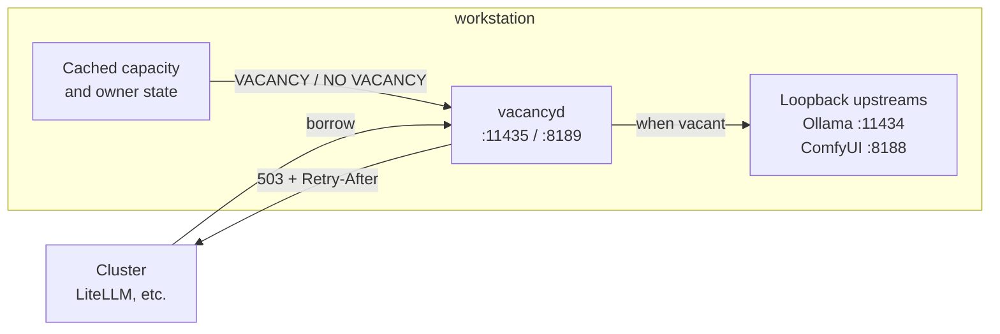

# vacancyd

[](https://vacancyd.com/)

**Keep your workstation. Let your homelab borrow its spare capacity for local AI.** Windows and Linux. Apache-2.0.

[App website](https://vacancyd.com/) · [Documentation](https://docs.vacancyd.com/) · [Setup guide](docs/setup.md) · [Release verification](docs/releasing.md) · [Security](SECURITY.md)

> **Release status:** source is available. Signed version 1.0.0 downloads and container images are being prepared; a source tag alone isn't a published binary release.

Your workstation may be one of the most powerful computers in your homelab. It might have the best GPU you own. It's also the machine you use for games and everyday work, and for a good chunk of the day, much of that capacity sits unused.

Putting it to work for the rest of the homelab can mean changing what that machine is. Turn it into a cluster node or virtualization host, and now you're figuring out how to get your desktop back through a thin client or GPU passthrough. The GPU can still end up tied to one environment. Keep the workstation separate, and your other machines may be struggling for capacity while it has room to spare.

vacancyd gives you a hybrid option. Your workstation stays a workstation, running its own operating system and the applications you use. Other applications in your homelab can borrow its spare capacity for local AI work through services running on it. You choose what they can borrow and when. The workstation doesn't have to join the cluster, and you don't have to move your desktop into a virtual machine to make its GPU useful elsewhere.

The name comes from a motel's vacancy sign. **VACANCY** means there's room for a new temporary resident: a borrowed workload. **NO VACANCY** means the machine isn't accepting that work under the current rules. Put vacancyd in front of a dedicated AI service and point borrowers at the gate. A refusal returns HTTP 503, a reason and `Retry-After`, which a borrower can use to wait or try another machine if configured to do so. Gateway failover depends on the gateway's adapter and configuration.

## You set the house rules

vacancyd checks owner activity, available resources and the requirements of the requested workload before letting it through. Configure measured model footprints and dependencies across GPU memory, system memory and CPU. Missing or stale required readings withhold new work. Supported integrations include Ollama, llama.cpp, ComfyUI, Chatterbox and the documented routes of OpenAI-compatible servers.

By default, an upstream uses `owner_scope = "host"`, so owner presence can refuse its new work. Accepted work follows its configured cancel, drain or finish policy; the default drain window is 30 seconds. Closing a proxy connection doesn't prove that the upstream stopped computing or released memory. Automatic model unloading is a separate, adapter-specific option.

An upstream set to `owner_scope = "resource"` can keep lending while the owner is present, subject to its resource checks. GPU pressure can reclaim affected work; memory and CPU capacity checks refuse new work but don't reclaim accepted work. Status and the console name exempt routes. Direct requests to the inference server bypass the gate, so keep its listener inaccessible to borrowers.

## The owner console

See what's lending, what's withholding and why. The console brings resource readings, workload decisions, supported settings and diagnostics together, with a pause control when you need it.


*The version 1.0.0 console rendered with example data, not measurements from a user machine.*

| Your question | Where to look |
| --- | --- |
| Can the machine lend right now? | The overview shows owner policy, resource checks and the vacancy sign. |
| Why was a request refused? | Workloads show route decisions and required resources. |
| How do I pause or change lending? | Use the console's supported controls; privileged changes require local administrator approval. |
| What does an owner return mean for active work? | The route's configured cancel, drain or finish policy decides. See [admission and recovery](docs/admission.md). |


*Example workload configuration. [Explore the console](docs/console.md) or [start with setup](docs/setup.md).*

## Where it fits



## What it does

- **Gated reverse proxy** in front of Ollama, ComfyUI, Chatterbox TTS, or the supported routes of an OpenAI-compatible server. The `llamacpp` adapter adds llama.cpp slot observations; the generic `openai` adapter does not establish compatibility with every server or endpoint. See the [adapter route tables](docs/architecture.md#proxy-srcproxyrs). One listener per upstream. Listed discovery and health routes pass through so a borrower's checks keep working. Routes that manage the upstream or read the owner's data on it, such as pulling models or reading the prompts llama.cpp is processing, are refused unless you allow them per upstream. Anything vacancyd does not recognize is refused rather than guessed at, and request bodies are bounded in size, memory and time. WebSocket upgrades are tunneled, so ComfyUI queue and progress updates work while the real service remains bound to loopback.
- **Per-model admission.** "Is there room?" depends on which model is asked for: a 12B may fit right now while a 20B must wait. You configure measured footprints. vacancyd reads the model name from each request and checks the card's *actual* free VRAM before letting it through.
- **Host policy plus per-resource pressure.** Session state, media playback, and an explicit process list can reserve the whole machine for its owner. On Windows, attributed GPU utilisation separately refuses only the GPU used by work vacancyd did not admit. Unknown or stale required measurements refuse admission. An always-on lane on a card you never use, such as a small helper model on a display GPU, can opt out of host policy with `owner_scope = "resource"`; only its own resources then refuse or reclaim it (see [resource-scoped upstreams](docs/admission.md#resource-scoped-upstreams)).
- **Targeted yield.** With `yield_on_veto` enabled, supported adapters ask affected upstreams to unload models after their reclaim policy permits it. An acknowledgement is not proof that GPU memory has been recovered. See [admission and recovery](docs/admission.md#owner-return).
- **Prometheus metrics** (`/metrics`) so the borrowing side can watch the lender's true state continuously: free VRAM, veto state, admissions, active work by lifecycle phase, authentication decisions, refusals, yields. CPU exports utilization rather than meaningless free/total byte series.
- **Runtime switches.** Disable lending globally or per resource without restarting: `POST /admin/lending/disable`, `POST /admin/resources/gpu0/disable`. Every admin request carries the explicit `X-Vacancyd-Admin: 1` intent header in addition to any required credential. On Windows and Linux, local changes other than pausing need an administrator identified from the caller's account by the kernel: an elevated Windows administrator, for whom the owner console asks for approval, or on Linux root or a member of the `vacancyd-admin` group, using `vacancyd admin-request` (see [authentication](docs/authentication.md)).
- **Built-in diagnostics.** A temporary debug logging window that turns itself off, and a diagnostics export with the last six hours of GPU pressure decisions, from the owner console or `vacancyd diagnostics export` (see [logging and diagnostics](docs/diagnostics.md)).
- **Resources beyond GPUs.** Every GPU, system memory and CPU are first-class resources with their own lendability rules, and an upstream can require several at once (`also_requires`).
- **Knows when you walked away.** A session-0 service cannot read idle time, so vacancyd ships a companion agent. `vacancyd-session.exe` runs without a console; `vacancyd agent` shares its client code for foreground diagnostics. One agent per interactive session reports idle time plus the foreground app over an ACL'd named pipe. Set `idle_lends_after_s` and an unlocked machine you have wandered off from becomes lendable. Without the agent the daemon simply stays conservative. A missing or dead agent can never *increase* lending.
- **Designed for extension in source.** Hardware probes, server dialects, and OS presence backends are separated behind Rust traits and compile-time registries. This is not a runtime plugin ABI: adding AMD GPU probes, a server-specific adapter, or a macOS presence backend means changing and rebuilding vacancyd. A server can already use the generic OpenAI-compatible adapter where its routes match the documented contract.

## What it deliberately is not

- **Not a scheduler or a cluster node.** Your machine never joins anything. The cluster's view is one URL that is sometimes closed.
- **No external control plane or telemetry.** vacancyd needs no marketplace account. Listener addresses, upstream destinations, firewall rules and TLS are controlled by the operator; the daemon does not enforce LAN confinement.
- **Not an interceptor of your own use.** Local work talks to the real service port as before. Only borrowers go through the gate.

## Install

### Windows

Once the signed release is available, download its x86-64 MSI from the project's Releases page and double-click it. The installer adds vacancyd as a native automatic Windows service, so no service wrapper or Rust installation is required. Its deliberately inert starter configuration is written to:

```text
C:\ProgramData\vacancyd\vacancyd.toml
```

The MSI adds Start menu setup and session-agent shortcuts, plus an all-users logon shortcut for the windowless session reporter. For an already-open session, choose **Start session agent** without elevation; see [startup and upgrades](docs/agent-startup.md). Right-click **Setup (run as administrator)** and choose **Run as administrator**, or use an elevated PowerShell prompt:

```powershell
& "$env:ProgramFiles\vacancyd\vacancyd.exe" setup `
  --config "$env:ProgramData\vacancyd\vacancyd.toml" --replace-starter
```

Setup discovers candidate GPUs and services, asks about capacity and GPU pressure policy, and writes a validated configuration with a separate private borrow-only token. It preserves a backup of the starter and refuses to replace customized configurations. It does not activate lending, configure your upstreams, or change the firewall. Follow [`docs/setup.md`](docs/setup.md) to verify and activate it. This is guided command-line setup, not yet a one-click onboarding UI. Keep the real upstream loopback-only where possible: direct requests to a network listener bypass vacancyd's owner protection, although a network bind alone does not establish Internet exposure.

Advanced configurations still use `vacancyd.example.toml` and `vacancyd check-config --config <path>`. Upgrades and uninstall preserve the configuration. See [`docs/windows-service.md`](docs/windows-service.md) for service, firewall, and desktop-agent details. The [v1 compatibility contract](docs/compatibility.md) describes configuration upgrades, status clients and reporter version matching.

### Linux

Once the release is available, download its archive for `x86_64-unknown-linux-gnu`, verify the adjacent SHA-256 sidecar, and follow [Linux: install from the release archive](docs/setup.md#linux-install-from-the-release-archive): install the binary, turn `vacancyd.example.toml` into your configuration, validate it with `vacancyd check-config`, then install [`contrib/vacancyd.service`](contrib/vacancyd.service). An `aarch64-unknown-linux-gnu` archive is also published as a preview: its build and package contents are checked, but v1.0.0 does not claim runtime qualification on physical ARM64 hardware. Linux’s default systemd-logind presence backend treats an unlocked local or graphical session as occupied, and locked or SSH-only sessions as unattended. Resource checks and route policy still decide admission. Attributed GPU pressure is not implemented on Linux yet. See the platform table below before enabling lending. Local changes other than pausing go through `vacancyd admin-request` as root or a member of the `vacancyd-admin` group; see [local administration on Linux](docs/authentication.md#local-administration-on-linux).

### Container

The release images are intended for a Linux machine nobody sits at, such as a dedicated GPU box whose inference servers already run in containers. These pull commands become available when the images are published:

```sh
docker pull docker.io/probablyfinedev/vacancyd:latest
docker pull ghcr.io/maxfield-allison/vacancyd:latest
```

The image holds the binary from the Linux release archive, runs as an unprivileged user and reads `/etc/vacancyd/vacancyd.toml` from a read-only mount. Use `owner.presence = "headless"` there, and give it NVIDIA GPUs with the NVIDIA Container Toolkit (`--gpus`). Reading desktop presence from the host's systemd-logind is possible but needs extra host access. [`docs/container.md`](docs/container.md) covers configuration, ports, state, GPUs, the logind mode and verifying an image's signature and attestations.

### Verifying a download

Every release publishes a `SHA256SUMS` file covering all of its files, signed with the project's release key ([`packaging/cosign.pub`](packaging/cosign.pub)). With [cosign](https://docs.sigstore.dev/cosign/system_config/installation/):

```sh
cosign verify-blob --key cosign.pub --bundle SHA256SUMS.sigstore.json SHA256SUMS
sha256sum --check --ignore-missing SHA256SUMS
```

The Windows MSI and executables are also Authenticode-signed. Releases are built, signed and published from the tagged source by the maintainer's release pipeline, which refuses to build a tag that differs from the source it builds; [`docs/releasing.md`](docs/releasing.md) describes it. Development builds are not presented as supported releases.

## Developer quickstart

To build from source, use Rust 1.89 or newer.

Before running the example on Windows, use the MSI's protected `ProgramData\vacancyd` folder, or create and protect it as described in the [manual service procedure](docs/windows-service.md#procedure). Put the development configuration inside it and pass that file's path with `--config` to `check-config` and `run`. Its default recovery directory and pressure cache then stay inside the protected folder too. A configuration kept elsewhere needs explicit `server.admission_state_dir` and `owner.gpu_pressure.state_file` paths inside that folder. The owner console cannot save changes to a configuration kept elsewhere. Preserve existing recovery records when changing their location; see [migration](docs/setup.md#protected-windows-configuration-and-migration). The relative paths below need these adjustments on Windows:

```console
$ cargo install --path .
$ cp vacancyd.example.toml vacancyd.toml   # edit: your GPU UUID, your games,
                                           # model footprints, auth and binds
$ vacancyd check-config
vacancyd.toml OK
$ vacancyd run                 # the service (on Windows, from an elevated prompt)
```

On Windows, run `vacancyd agent` in a second, non-elevated terminal in your desktop session. The `agent` subcommand exists only in Windows builds; Linux uses systemd-logind for session presence. See [session-agent startup](docs/agent-startup.md) for Windows startup and diagnostics.

Configure a `borrow` token and change the gate listener from loopback to a LAN address, then point the borrower at it (e.g. LiteLLM `api_base: http://<machine>:11435` instead of `:11434`). Check the sign:

```console
$ vacancyd status
lending: ON   owner veto: clear
  gpu0   NVIDIA GPU A                    12000 MiB free /    16000 MiB   util   5%   lending
  gpu1   NVIDIA GPU B                     6000 MiB free /     8000 MiB   util  11%   lending
  mem    system memory                   30000 MiB free /    64000 MiB   util  53%   lending
  cpu    16 logical cpus              util      7%   lending
  ollama       0.0.0.0:11435 -> http://127.0.0.1:11434   VACANCY
  comfyui      0.0.0.0:8189  -> http://127.0.0.1:8188    VACANCY
```

When an upstream is exempt from the owner veto (`owner_scope = "resource"`), a second line names it, and while you are at the machine says whether it is still lending, for example `paused for host-scoped upstreams only; 1 exempt upstream still lending: chatterbox`.

### Measuring model footprints

Don't guess the per-model thresholds. Measure them once:

```console
$ curl -s localhost:11434/api/generate -d '{"model":"gemma3:12b","prompt":"hi"}' >NUL
$ curl -s localhost:11434/api/ps
# size_vram is the on-card footprint. Add ~500 MiB headroom.
```

That figure is what a request needs free when it may have to load the model. While the model stays resident, a request that reuses it as loaded is charged its `resident_min_free_mib` instead (default 0), so a borrower's follow-up turn is not refused for memory the model already holds. For Ollama, vacancyd credits a request only when it knows the request reuses the loaded context: its `options.num_ctx` equals it, it leaves `num_ctx` unset and the model's Modelfile fixes `num_ctx` to it, or an earlier request of the same kind (including one that left `num_ctx` unset, or used `/v1`) was seen to load exactly it. What was learned survives a restart of vacancyd. A request that changes another runner option is charged the full figure.

A scalar `[upstream.models]` value applies to every NVIDIA GPU dependency, and to the primary resource when that is system memory, as on a CPU-only upstream. A memory requirement is charged on top of that resource's owner `reserve`. For a split model, use a per-resource map such as `"split-model" = { gpu0 = 10000, gpu1 = 14000 }` and name every NVIDIA GPU dependency explicitly. Pin the dedicated upstream process with the same stable GPU UUID used by the resource selector and verify a test load with `nvidia-smi`; numeric device indexes can be renumbered inside the process.

## Design notes

- **Refuse before forwarding.** Admission uses sampled policy and capacity before sending a work request to the upstream. A refused request does not begin the model load. This is not a latency or zero-contention guarantee; observations have a sampling cadence, and accepted work has its own reclaim policy.
- **Capacity and pressure are different measurements.** Total free VRAM from `nvidia-smi` answers whether a model fits. Windows GPU Engine counters answer which PCI adapter is busy and whether that work belongs to an upstream process tree. vacancyd does not use unreliable per-process VRAM accounting.
- **Presence is about the human. Pressure is about the resource.** A locked machine with an idle game still loaded can be lendable, while a background render can reserve only the GPU it is actually using. Keeping those facts separate avoids turning every signal into a machine-wide veto.
- **`nvidia-smi`, not linked NVML.** It ships with NVIDIA's driver tooling on the supported Windows and Linux targets. Calls are isolated behind hard deadlines, so a stuck driver tool cannot stop presence sampling. On Windows it and the system tools are run by full path, never found through PATH.
- **Engage fast, release slow.** The veto fires on one sample (protect the game *now*) and releases only after a grace period (don't resume lending because someone checked Discord).

## Security

The API and proxy use scoped bearer tokens: `borrow` for the hardware, `read` for presence-bearing status and metrics, and `admin` for runtime switches. Loopback is trusted by default, for reading everywhere and for pausing on Windows and Linux; other changes there need an administrator identified from the caller's account (an elevated Windows administrator, or on Linux root or the `vacancyd-admin` group). A config with no tokens may bind only to loopback. Remote listeners fail validation unless the operator sets the conspicuous `allow_unauthenticated_remote` escape hatch. Tokens travel over HTTP, so use a trusted LAN or terminate TLS in front; a TLS proxy on the same machine requires `trust_loopback = false`. See [`docs/authentication.md`](docs/authentication.md). Report a vulnerability privately as described in [`SECURITY.md`](SECURITY.md).

## Platform support

| Platform | Capacity | Host presence | Attributed GPU pressure | Local administration | Proxy/API |
| -------- | -------- | ------------- | ----------------------- | -------------------- | --------- |
| Windows x86-64 | NVIDIA, CPU, RAM | WTS + user-session agent | GPU Engine counters, exact PCI mapping | by Windows account over the admin pipe; loopback reads and pauses | supported for a local interactive session |
| Linux x86-64 | NVIDIA, CPU, RAM | systemd-logind sessions + owner-process scan | not implemented (remains unknown) | by uid and groups over the admin socket; loopback reads and pauses | supported |
| Linux ARM64 | NVIDIA, CPU, RAM | systemd-logind sessions + owner-process scan | not implemented (remains unknown) | by uid and groups over the admin socket; loopback reads and pauses | preview; build and package verified |
| macOS | CPU and RAM code paths only | no presence backend | not implemented | loopback trust grants every admin action | unsupported for 1.0.0; no release package |

Linux should leave `owner.gpu_pressure.enabled` false until the DRM fdinfo backend is implemented. Its presence backend reads systemd-logind over the system D-Bus:

- A user session counts as someone at the machine when it is graphical (X11, Wayland, Mir, local or remote) or a local console login on a seat. SSH sessions, the per-user service manager and background sessions do not count.
- An unlocked counted session in the foreground refuses; a locked one lends once `owner.release_after_s` (120 s by default) has passed since the session was last unlocked. Nobody signed in, including a display-manager greeter, lends once two consecutive reads agree and that same hold has passed.
- `idle_lends_after_s` works only when the desktop reports an idle hint to logind. Playback and the foreground window are not read on Linux, so idle lending there cannot tell a film from an empty chair unless the player inhibits idle.
- `owner.processes` is matched against the processes of the user at the unlocked desktop.
- If logind cannot be read, lending is refused. A host without systemd-logind sets `owner.presence = "headless"`, which stops consulting presence at all.

macOS is unsupported for this release. Its development code has no presence backend: it reports an unknown session and can lend on capacity and switches alone, even with someone at the desktop. Do not infer owner protection from a successful macOS source build. Windows Home qualification does not establish RDP hosting or two concurrently active interactive sessions. Those broader session cases are outside the v1.0.0 support claim.

See [`docs/prior-art.md`](docs/prior-art.md) for why this exists rather than a configuration of something that already did, [`docs/tiers.md`](docs/tiers.md) for the availability tiers and how to measure them, and [`docs/architecture.md`](docs/architecture.md) for the internals.

## License

Licensed under the [Apache License, Version 2.0](LICENSE-APACHE). Third-party components retain their own licenses; see [THIRD_PARTY_LICENSES](THIRD_PARTY_LICENSES).
