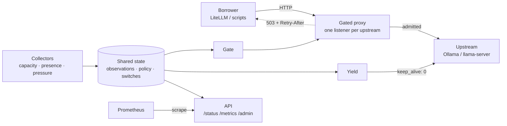

# vacancyd architecture

GPU pressure learns its threshold by default, from a decaying histogram of each GPU's load, bounded by a cap that work cannot teach it past; see [calibration.md](calibration.md) for the model, readiness and the saved cache. A learned threshold falls at once and rises at a bounded rate per observed hour.

This document covers vacancyd's components and the decisions behind them. It assumes the borrower can reach the lender over HTTP.

## The problem, precisely

A machine has hardware that is idle most of the time (a gaming GPU, 64 GB of RAM, 32 threads). Something else on the network, such as a Kubernetes cluster, a second box or a gateway like LiteLLM, would like to use it. Two constraints make the naive solution ("point the cluster at the box") wrong:

1. **Owner policy controls host-scoped admission.** Refuse a new borrowed request before forwarding it when sampled presence or required resources do not permit it. A resource-scoped upstream can opt out of owner presence; its own resource checks remain in force.
2. **The borrower needs a usable refusal.** HTTP 503 carries a reason and retry hint. Whether a gateway selects a fallback depends on its adapter and configuration.

Admission cannot promise zero contention or immediate hardware recovery. Presence is sampled, accepted work follows cancel, drain or finish policy, and a closed connection does not prove upstream cancellation. See [admission and recovery](admission.md).

## Components

### Collectors (`src/collect/`)

Write timestamped observations into shared state. Capacity uses the general poll interval (default 3 s); host presence and attributed pressure have independent paths and pressure has its own cadence. All probes are read-only; none allocate on the hardware they measure.

Capacity, host presence, and attributed pressure run as independent loops. Each synchronous probe runs on Tokio's blocking pool, and every subprocess has a hard deadline and is killed if it exceeds it. A slow GPU counter query therefore cannot delay the session-state sample that takes the machine back.

- **NVIDIA capacity** shells out to `nvidia-smi --query-gpu=...` once per poll and parses CSV. Chosen over linked NVML deliberately: `nvidia-smi` ships with supported NVIDIA driver installations on Windows and Linux and avoids a linked NVML dependency. Collector subprocesses have deadlines; their overhead is not a performance guarantee.
- **System capacity** uses `sysinfo` for memory and CPU, and for resolving a PID to a process name.
- **Host presence** reads session state from the OS. Windows enumerates WTS sessions and takes idle time and the foreground app from verified per-session reporters. Linux reads systemd-logind over the system D-Bus (`ListSessions` plus one `GetAll` per session, on a connection kept open between polls, so no subprocess is spawned): graphical and local console user sessions count, SSH sessions do not, `LockedHint` is the lock screen, and idle comes only from the desktop's `IdleHint` and `IdleSinceHintMonotonic`. The owner-process list is matched against a `sysinfo` scan of the processes of the user at the unlocked desktop, taken only while such a session exists. An unreadable logind is an unknown session that refuses. macOS has no backend and returns an unknown signal that does not refuse; it may gate on capacity, but an enabled platform-specific pressure input that cannot be sampled still fails closed. `owner.presence = "headless"` replaces the backend on any platform with a fixed logged-out reading.

### The measurement stance that shaped this

Per-process VRAM accounting looks like the obvious signal for "is a game running" and it does not work on Windows: NVML reports `N/A` for graphics processes, and the WDDM `GPU Process Memory` counters can substantially over-report. vacancyd therefore uses two different measurements for two different questions: total free VRAM from `nvidia-smi` for capacity, and WDDM GPU Engine utilisation for per-process pressure. D3DKMT PCI identity joins those engine counters to the selected NVIDIA device; memory correlation is never used as identity.

### Shared state (`src/state.rs`)

- One capacity observation per configured resource, with explicit `unknown`, `ready`, and `stale` quality rather than a plausible default.
- A host-wide **policy veto** for explicit owner signals. It engages on one matching sample and releases only after `release_after_s` of consecutive clear samples.
- A per-resource **pressure guard** for attributed GPU utilisation, including observation quality, mapping provenance, threshold, and independent hysteresis. The processes serving upstream targets on this machine, and their descendants, are subtracted by `(pid, start_time)` identity; this remains an approximation, not request provenance, when owner and borrower share one server process. A target on another host, or named by a host name other than `localhost`, never selects a local process by its port. When a listener only relays connections, for example into a virtual machine or a container, the GPU work runs outside its process tree and counts as owner load. vacancyd does not guess which other process is the borrower's, because subtracting it would also hide the owner's own work run the same way. After three attribution samples in which an upstream has admitted work running and no process in that tree uses a GPU, vacancyd logs a warning. It reports the upstream's `unseen_gpu_work` in `/status`, and `vacancyd status` prints a line under the upstream. The report clears when a process of the tree is seen using a GPU. Nothing extra is subtracted.
- Runtime switches: a global `lending_enabled` and one `enabled` per resource, both atomics flipped through the admin API.

### Gate (`src/gate.rs`)

Pure decision logic, unit-tested without I/O. In order:

1. Global lending switch off → refuse (`lending_disabled`, retry 300 s).
2. Presence not yet sampled since startup → refuse (`owner_active`, retry 5 s), the same condition that keeps `/readyz` unready. For a host-scoped upstream, a presence sample older than four general polls (at least 15 s) also refuses (`owner_active`, retry 5 s) and keeps `/readyz` unready. If no replacement reading arrives before expiry, the presence loop engages the owner veto. Its rising edge starts reclaim of borrowed host-scoped work under each upstream's configured cancel, drain or finish policy. Pressure learning pauses while presence is stale, and a sample that takes longer than the freshness bound is discarded. A fresh clear reading releases the veto only once `release_after_s` has elapsed since its last matching observation.
3. For a host-scoped upstream (the default), an active session without complete session evidence (a required reporter has not posted a fresh observation, or Windows could not form one consistent session view) → refuse (`owner_active`, retry 30 s). A session vacancyd cannot read clearly is never treated as an absent owner. A Linux session read from systemd-logind needs no reporter and goes straight to the policy veto.
4. For a host-scoped upstream, host policy veto active → refuse (`owner_active`, retry 120 s). An upstream with `owner_scope = "resource"` skips steps 3 and 4 and answers only to the checks below; `/status` lists it in `owner_veto.exempt_upstreams` (see [resource-scoped upstreams](admission.md#resource-scoped-upstreams)).
5. For the primary resource and every `also_requires` dependency, in order: its runtime switch off → refuse (`resource_disabled`, retry 300 s); its capacity unknown/stale → refuse (`resource_unmeasured`, retry 30 s); its probe policy not lendable → refuse (`insufficient_capacity`, retry 30 s); and where pressure applies, its per-resource pressure observation unknown/stale/uncalibrated → refuse (`resource_unmeasured`, retry 30 s) or engaged → refuse (`resource_pressured`, retry 30 s).
6. Per-model capacity: the request's `model` is looked up in the upstream's table of measured footprints (or the default); if live free capacity is below it → refuse (`insufficient_capacity`, retry 30 s). When the upstream already holds the model as the request needs it, the smaller `resident_min_free_mib` is charged instead (see below).

The per-model step is what makes the gate honest rather than binary. With 11,400 MiB free, a configured 10,000 MiB load can pass the memory check while a 14,000 MiB load cannot. Parameter counts alone do not establish a footprint. A single "busy/idle" flag would either lie or waste the card.

A model that is already loaded is not in free memory any more, so charging its load requirement again would refuse its own follow-up requests. The gate therefore credits residency, but only on proof. The upstream's model observation must be ready, at most 4 s old, and taken after the last job or yield on every dependency (a model that a yield unloaded is not still resident). Then, by adapter:

- `ollama`: `/api/ps` lists the requested model under its canonical name, its `expires_at` parses and is at least 30 s away, the request sets no runner option other than `options.num_ctx`, and the resident `context_length` is one the request is known to reuse. Ollama reloads a model whose runner options change, and resolves an unset `num_ctx` from its own defaults, so the context is known only when the request's explicit `num_ctx` equals it, or when an earlier request of the same kind (model, explicit or unset `num_ctx`, `/api` or `/v1`) was seen to load exactly it. That learned map covers requests without `num_ctx`, every `/v1` request, and parallel slots, which report a multiple of the requested context. It is kept with each model's digest across restarts. A request that leaves `num_ctx` unset is also credited when the model's Modelfile sets `num_ctx` to the resident context, read from `/api/show` once per digest, unless a learned context shows parallel slots.
- `llamacpp`: the server holds one model for its lifetime, so fresh idle `/slots` prove it resident.
- `comfyui`: `/system_stats` reports `torch_vram_total`, memory ComfyUI's own allocator holds and reuses for the next job. On a route with exactly one GPU it is added back to free memory for that GPU.

A credited request is charged `resident_min_free_mib` (default 0, never more than the load requirement) on every budgeted dependency, in place of both the configured requirement and a learned footprint prior. Memory that evicting another idle model would free is never credited. Anything unproved charges the full requirement. When the proof failed only because the observation was too old, the refusal path takes one fresh observation and decides again. Refusal details say whether a credit applied and why not; `/status` reports an applied credit as `residency`, and the daemon logs each credited admission.

A request the gate admits still has to clear the admission ledger (`src/admission.rs`), which runs immediately after and is not part of the pure decision above: it holds one job at a time per resource and refuses a second concurrent one with `resource_busy` (retry 2 s) while the first is reserved. A resource the gate would otherwise admit can therefore still be held by another request's reservation. Where an upstream identifies a loaded model, the ledger also keeps a conservative measured-footprint prior per model, and a resource it releases needs a fresh post-completion capacity sample before the gate will admit into it again; see [admission and recovery](admission.md) for both.

### Proxy (`src/proxy.rs`)

One axum listener per `[[upstream]]`. Each request is classified by its dialect's adapter into one of five classes, after dot segments in the path are resolved the way the forwarding URL resolves them. Classification fails closed for every method: a borrower reaches only the routes an adapter recognizes.

| Class | Proxy behavior |
| ----- | -------------- |
| work | admitted through the gate, then forwarded |
| pass-through | forwarded without admission: the listed discovery, health and result reads below, and cheap utilities that run no model |
| management | forwarded without admission only when the upstream sets `management = "allow"`; otherwise `403` with `error.type = "management_denied"` |
| unlisted read | any other `GET` or `HEAD`: treated as management, because an unlisted read can return the owner's data |
| unrecognized route | any other method on any other route (including `OPTIONS`): `501` with `error.type = "unrecognized_route"`, never forwarded or reserved, whatever `management` says |

| Dialect | Work (`POST`) | Borrower reads (`GET`, `HEAD`) | Other pass-through | Management |
| ------- | ------------- | ------------------------------ | ------------------ | ---------- |
| `ollama` | `/api/chat`, `/api/generate`, `/api/embed(dings)`, `/v1/{chat/completions,completions,embeddings,responses,messages}` | `/`, `/api/version`, `/api/tags`, `/v1/models`, `/v1/models/<model>` | `POST /api/show` | `POST /api/{create,copy,pull,push}`, `DELETE /api/delete`, `POST`/`HEAD /api/blobs/<digest>`, `GET /api/ps` |
| `openai`, `llamacpp` | `/v1/{chat/completions,completions,embeddings,responses,messages,rerank,reranking}`, `/{chat/completions,completions,embeddings}`, and llama.cpp's `/completion`, `/infill`, `/embedding`, `/rerank`, `/reranking` | `/v1/models`, `/models`, `/health`, `/v1/health` (health without a query string) | `POST /tokenize`, `/detokenize`, `/apply-template`, `/v1/messages/count_tokens` | `POST /props`, `/slots/<id>`, `/lora-adapters`, `/models/{load,unload}`, vLLM's `/v1/{load,unload}_lora_adapter`; reads of `/slots`, `/metrics`, `/props`, `/lora-adapters`, and `/health` with a query |
| `comfyui` | `/prompt` (also under `/api`) | `/prompt` (queue length), `/ws`, `/history/<prompt_id>`, `/api/jobs/<id>`, `/view`, `/object_info[/<node>]`, `/models[/<folder>]`, `/embeddings`, `/system_stats` (each also under `/api`) | none | every `POST`/`DELETE` the web UI makes (`/free`, `/interrupt`, `/queue`, `/history`, `/upload/*`, `/users`, `/settings`, `/userdata/*`, job cancel), reads of the owner's data (`GET /history`, `/queue`, `/jobs`, `/users`, `/settings`, `/userdata`, `/internal/*`), and ComfyUI-Manager on any method |
| `chatterbox` | `/v1/audio/speech`, `/v1/audio/executions` | `/healthz`, `/readyz`, `/v1/audio/voices`, `/v1/audio/execution-capabilities`, `/v1/audio/executions/<id>`, `/v1/audio/execution-audio/<id>` | none | `POST`/`DELETE /v1/audio/voices`, `POST /admin/unload`, `GET /status` |

`llamacpp` uses the `openai` table and additionally requires fresh `/slots` observations for admission.

Passing discovery and health routes through unconditionally is important: the borrower's own health checks keep seeing a live service while lending is off, so it treats the refusal as "no room" rather than "host is dead". A ComfyUI borrower keeps `GET /history/<prompt_id>`, `/jobs/<id>`, `/view`, `/ws` and the node and model catalogue. `/view` serves any file in the instance's output, input and temp folders by name, and `/ws` relays progress, including previews, for prompts submitted without a client ID, which is why the upstream must be an instance dedicated to borrowed work.

The borrower reads are the minimum a client needs to find a model and check health, plus a ComfyUI client's own results. Reads that show what the owner is doing or how the server is configured are management: llama.cpp's `/slots` returns the prompts each slot is processing, `/metrics` counts the owner's requests and tokens, and `/props` exposes the model's file path and server settings. Ollama's `/api/ps` shows which models are loaded and, from their unload time, when they were last used; Chatterbox's `/status` says whether it is generating right now. vacancyd's own observation of the same facts is readable only with the `read` scope. A health check needs no query string, and llama.cpp's health parameters (`include_slots`, `fail_on_no_slot`) read slot state, so `/health` with one is management too. Listed reads match exactly, both as sent and percent-decoded, so `/%73lots` and `/v1/models/..%2Fapi%2Fps` are unlisted.

An unlisted `GET` or `HEAD` could be a new upstream route that returns the owner's data, so it is refused with `403 management_denied`, and the refusal names the reads the borrower does have. `management = "allow"`, which already hands a borrower the upstream's administration, forwards it; that is the owner's explicit, per-upstream way to serve something like the ComfyUI web interface through the gate. Any other method on a route the adapter does not recognize is refused with `501` even then: an admitted request on such a route used to hold the resource until an administrator released it, and forwarding it would let a new upstream inference route bypass admission. Routes are matched exactly rather than by prefix, so lookalike paths do not inherit an exception. The refusal names the route and where to report it.

Request bodies are buffered so the model name can be read, within three bounds from `[server.limits]`. A body larger than `max_request_body_mib` (64 MiB by default) is refused with `413`, before any of it is read when its `Content-Length` says so. Each proxy holds at most `max_buffered_body_mib` (by default 256 MiB, or `max_request_body_mib` if that is larger) of bodies at once: a body reserves its share before its bytes arrive, keeps it until it has been forwarded, and one that would pass the budget is refused with `503` and `Retry-After`, so memory stays bounded however many connections send bodies together. A refused request's body is read and dropped in the background, up to twice the size limit, so a client still sending it receives the refusal rather than a connection reset. Response bodies **stream**, so NDJSON/SSE token streaming passes through unchanged. Hop-by-hop headers, headers named in `Connection`, and `Proxy-*` credentials are dropped in both directions. Upstream redirects are returned to the borrower rather than followed, and proxy environment variables are ignored. A redirect whose `Location` names the upstream's own address (or a loopback name for it) is rewritten to a path on the proxy, so the borrower never learns the internal target. The borrower's `Authorization` header is not forwarded unless the upstream sets `forward_authorization`; an upstream with a `credential` instead receives vacancyd's own credential for it, on forwarded requests, WebSocket upgrades and vacancyd's own calls alike.

Every listener runs with a header-read timeout that also closes idle keep-alive connections, a cap on open connections, a request-body deadline (`body_read_timeout_s`) and idle timeout (`body_idle_timeout_s`) that start once the headers are complete and answer `408`, and a write-stall timeout (`write_stall_timeout_s`) that disconnects a client that stops accepting its response. Without the body timeouts, a client that sent headers and then withheld the body held its connection slot indefinitely, and a few such clients filled the listener. None of these applies to a response that is still being produced. Proxied WebSocket tunnels have their own cap and an idle timeout.

An authenticated `Connection: Upgrade` / `Upgrade: websocket` request is handshaken with the upstream and then tunneled byte-for-byte in both directions. The adapter still owns classification: ComfyUI's `GET /ws` is a pass-through progress channel, while `POST /prompt` remains the work-submission gate. Closing either side tears down the tunnel.

Before classification, scoped bearer authentication protects remote proxy requests. A `borrow` token reaches work and pass-through routes, and management routes where the upstream allows them; loopback may be trusted explicitly for the owner's direct use. Configurations with a non-loopback listener and no tokens are rejected unless the conspicuous `allow_unauthenticated_remote` escape hatch is enabled.

A refusal is `503 Service Unavailable` with `Retry-After` and a JSON body shaped like an OpenAI error (`error.type = "no_vacancy"`, `error.code` = the reason). Gateway failover depends on the adapter and configuration; verify the installed path as described in [503 interoperability](litellm-503-interop.md).

### Yield (`src/yield_control.rs`)

On owner return, new work is refused immediately. Accepted proxy work uses the upstream's `on_owner_return` policy: `drain` (default) cancels its connection after `drain_timeout_s` (default 30), `cancel` cancels immediately, and `finish` allows completion without an owner-return time limit. The first return fixes the deadline; later returns cannot extend it. Cancellation before response headers returns 503; after headers it interrupts the stream instead of reporting a successful end. A stalled borrower cannot delay closing the upstream connection. Discovery and progress WebSockets remain available; gated work WebSockets use the same policy as other work requests.

Owner return reclaims host-scoped upstreams only; an upstream with `owner_scope = "resource"` is neither refused nor cancelled nor unloaded by it.

GPU-pressure refusal uses the same policy and deadline for the affected upstreams, including additional resource dependencies. While the owner veto is active it reclaims only resource-scoped upstreams, since the veto has already reclaimed the rest. Each resource has its own reclaim channel; activity or event overflow on an unrelated resource cannot cancel its neighbors. The first owner or affected-resource event determines the deadline. Proxy cancellation does not depend on enabling model unloading.

An unknown pressure reading refuses new work at once but raises its resource-pressure edge only after staying unknown for the tracker's gap limit (`max_gap_ms`, three times `poll_ms` and at least 20 seconds, so that one missed sample, with the attribution read's own few seconds, is tolerated); the collector raises it on that poll even when it cannot sample. The gap counts from the last good sample, as the tracker's own gap rule does. A valid sample ends the episode without a reclaim, unless it arrives more than `max_gap_ms` after the last one, or is itself engaged or uncalibrated; then it reclaims at once. The edge's refusal says how long the reading had been unknown. A missed sample does not interrupt the pressure tracker, which interrupts itself when valid samples are more than `max_gap_ms` apart; it restarts only the release timer, so unobserved quiet never counts towards release while sustained load still engages.

A drain or finish wait re-checks its trigger with admission's own checks. When the owner checks would admit the upstream (presence sampled; for a host-scoped upstream, complete session evidence and no veto), every refused resource has a fresh, calibrated reading below its threshold that is not building towards engagement, and every other pressure-gated dependency admits, the reclaim stands down for that upstream: nothing is cancelled or unloaded, its hold ends under the admission lock as a completed reclaim's does, and a later edge starts a reclaim of its own. Each reclaim publishes its decision (waiting, stood down, proceeding) on the upstream's reclaim-phase channel, with the timestamps of the edges it answers, including those that coalesced into it. A proxy connection waiting out a drain follows the reclaim that answers one of its own edges, so the stream cut and the job cancellation agree, up to 30 seconds past its own deadline in case that reclaim never decides; with no such reclaim, for example on an upstream that neither cancels nor unloads, it applies the same check itself and otherwise waits for its own deadline.

On a host-policy or resource-pressure **rising edge**, adapters that can cancel upstream work (`can_cancel`, today ComfyUI) cancel the borrowed jobs they track at the same deadline, independent of `yield_on_veto`: ComfyUI deletes the borrowed prompt IDs from its pending queue and stops one only when the queue shows it running, by the narrowest request that release supports (see [admission](admission.md#owner-return)). vacancyd assigns each borrowed prompt's ID before forwarding it, so a submission whose reply is still in flight at the deadline is cancelled once the reply lands. Only work admitted before the edge is named. Cancellation requests name only borrowed prompt IDs. ComfyUI 0.3.57 to 0.25.x still has an interrupt race with the next prompt; 0.26.0 and later cancels under the queue lock. Finish mode never cancels. Affected upstreams with `yield_on_veto = true` are then asked to unload: immediately in cancel mode, when affected work ends or at the drain deadline in drain mode, and when affected work ends or `completion_timeout_s` passes in finish mode. Held work never defers unloading; it keeps its reservation and is logged with the reason. Repeated vetoes share one pending reclaim per upstream. Ollama lists resident models with `GET /api/ps` and unloads each with `POST /api/generate {model, keep_alive: 0}`; ComfyUI uses its `/free` API, unless its queue shows a running or pending prompt vacancyd did not admit through any upstream reaching that server, in which case the unload is skipped and logged. The read stops at the first such prompt within 16 MiB. An unconfirmed submission to the server or a failed read unloads as before. Upstreams yield concurrently and each has a ten-second deadline; yield work is detached from sampling so a dead service cannot stop the next presence poll.

Disconnect and unload are not a universal job-cancellation protocol. A ComfyUI submission can remain queued after its HTTP response, which is why it is cancelled through its queue API; an OpenAI-compatible server can continue detached work; an Ollama model can remain resident after a request ends. These adapters do not claim verified upstream cancellation from a closed connection. The admission ledger retains that uncertainty separately from the proxy transport's completion.

Why bother, if the OS would page the model out anyway? Because paging is not free: WDDM demotes the model to system RAM over PCIe *while the game is allocating*, and the cost lands on the owner's frame times. Handing the memory back before the game asks for it is the polite move, and it is the whole point of the daemon.

Generic OpenAI servers have no unload API; `llama-server` keeps its model resident by design. For those the gate still refuses new work during a veto while model residency remains controlled by the server and operating system. The gate does not guarantee memory recovery for those adapters.

### API and metrics (`src/api.rs`, `src/metrics.rs`)

`/status` (JSON), `/healthz`, `/readyz`, `/metrics` (Prometheus), the admin switches, the temporary debug logging window and the diagnostics export (see [logging and diagnostics](diagnostics.md)). Each upstream's `listener.state` in `/status` describes the socket that serves that upstream's own target: `loopback_only`, `listens_on_network`, `unknown` (no listener accepts the target's address and port), or `not_observable` (the target is not a loopback address, `localhost`, or an address of this machine's interfaces, so no local socket describes it). A failed listener-table read is an observation failure, shown as `unknown`. `/healthz` is process liveness. `/readyz` returns 200 only after every proxy listener is bound, presence has been sampled, and every enabled resource required by an upstream has fresh mandatory observations. Every gauge the gate consults is exported, so the borrowing side can build a "may I borrow right now" dashboard and alert on the lender's state instead of discovering it per request.

`vacancyd_active_work{upstream,phase}` reports current admission-ledger entries for the `forwarding`, `tracking`, and `held` phases. `vacancyd_auth_total{scope,outcome}` counts allowed as well as denied decisions; a successful borrow-scope decision increments `{scope="borrow",outcome="allowed"}`. CPU has no byte capacity, so it exports `vacancyd_resource_utilization_pct` but deliberately omits `vacancyd_resource_free_bytes` and `vacancyd_resource_total_bytes` for that resource. Do not interpret missing CPU byte series as a collector failure.

`/healthz` and the detail-free `/readyz` response are public. Status and metrics require `read`; runtime mutations require `admin`. Presence-bearing detail is therefore not exposed merely because an orchestrator needs a readiness probe.

The collector, API listener, and every proxy listener are supervised as essential tasks. If one exits or panics, the daemon exits nonzero rather than continuing to answer a misleading liveness check.

## The resource model

Resources are declared, not discovered, so that what participates in lending is an explicit decision:

| Kind | Sample | Lendable when |
| ---- | ------ | ------------- |
| `nvidia-gpu` | VRAM free/total, utilization | governed by upstream per-model thresholds |
| `system-memory` | available/total | `available >= reserve` bytes; a job's memory requirement must fit in `available - reserve` |
| `system-cpu` | load % | `load <= reserve` percent |

For per-process GPU pressure on Windows, `nvidia-smi` supplies the selected GPU's stable PCI address and D3DKMT supplies the exact PCI-address-to-LUID inventory used by the performance counters. `resource.adapter` can declare the PCI address explicitly. Duplicate, missing, or conflicting identities remain `Unknown`; load and memory values are never used to guess a mapping.

Each has an `enabled` flag (startup) and a runtime switch. The primary resource and every `also_requires` dependency participate in admission. Today only GPU pressure is attributed; CPU and RAM have capacity policy but do not yet distinguish owner work from borrowed work.

## Where the numbers come from

Thresholds in `vacancyd.example.toml` are examples, not measurements of your hardware. Measure each model and context before using them. The method that produced them, reusable on any Ollama host:

1. Start with the model unloaded, and load it with the context your clients use: `POST /api/generate {"model": M, "prompt": "hi", "options": {"num_ctx": N}}`.
2. Read `GET /api/ps`: `size_vram` is the on-card footprint. If `size_vram < size`, the model spilled to CPU and does not fit.
3. Set the model's load requirement to `size_vram` plus ~500 MiB headroom. It is what a request needs free when it may have to load the model, and it is not charged again while the model stays resident and the request reuses it as loaded.
4. Leave `resident_min_free_mib` at 0 unless requests to the loaded model still allocate memory (a runtime that grows its cache per request). Then measure free VRAM before and during a request to the resident model and set it to that difference plus headroom.

And measure the *owner's* footprint the same way: sample free VRAM with the desktop up, then with your heaviest game up. The gap between those two numbers is the case for this daemon.

## Deliberate current limits

- Linux presence reads session state, locks, the desktop's idle hint and the owner-process list, but not media playback, the foreground window or precise input idle time. Those need a per-session Linux agent. Until then, idle lending on Linux depends on the desktop setting logind's idle hint, and a film only holds the machine if its player inhibits idle. Linux per-process GPU attribution remains a separate design concern.
- macOS has no host-presence backend yet, so it reports an unknown session and lending there depends on capacity and GPU pressure alone, with no owner-presence veto. That is blunter than the Windows and Linux signal, not more cautious.
- CPU and RAM pressure attribution is not implemented. Their capacity checks refuse new work; a later capacity shortage alone does not reclaim accepted work. Host-scoped work still follows the owner-veto reclaim policy.
- Background OpenAI Responses (`"background": true`) are refused, because their work outlives the reply that would release the reservation.
- Borrowed work is serialized across shared resource dependencies. Completion uncertainty retains a durable hold; see [admission and recovery](admission.md).
- Request bodies are limited (64 MiB each and 256 MiB per proxy by default) and buffered for classification; response bodies stream.
- The Rust traits and registries are extension seams for contributors, not a dynamically loaded plugin interface or stable external ABI.
